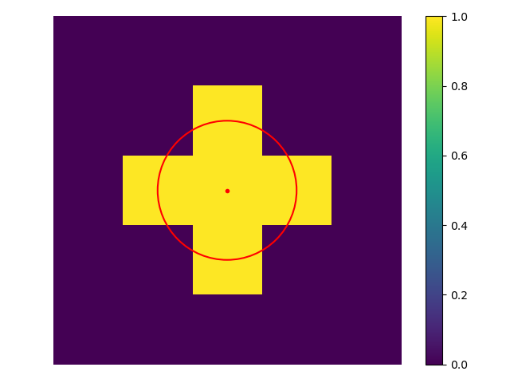
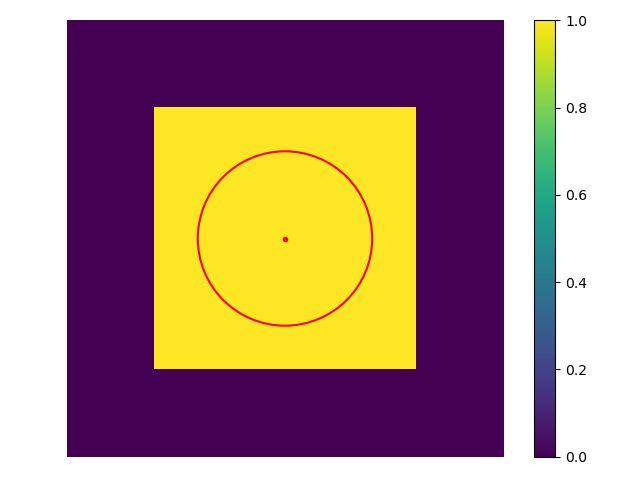
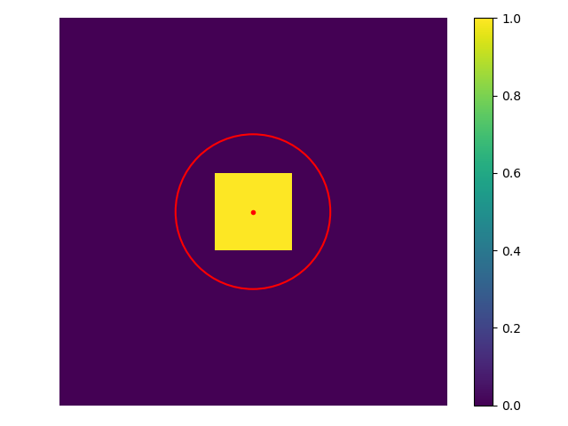
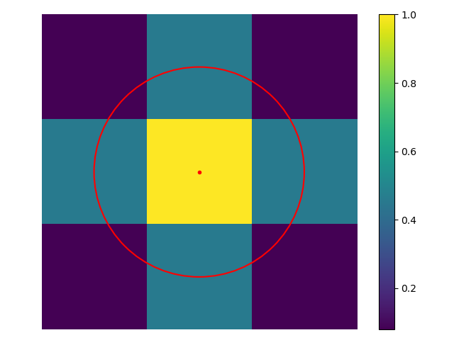
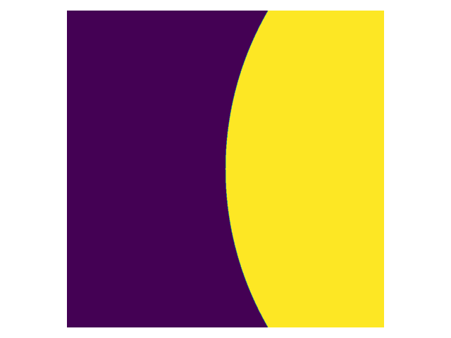
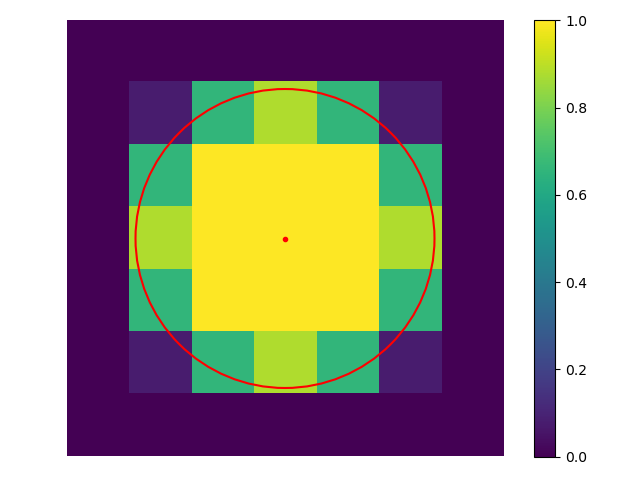
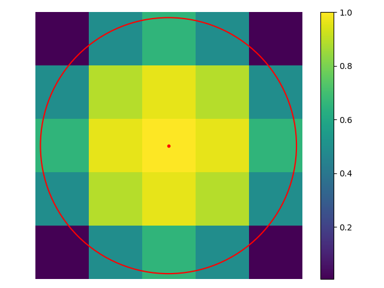
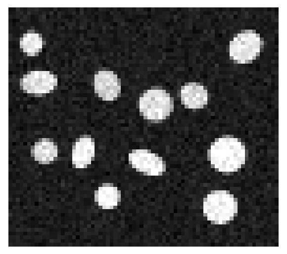

# fluoscenepy
[](https://github.com/sklykov/fluoscenepy/actions/workflows/test.yaml)
[](https://pypi.org/project/fluoscenepy/) 
[](https://github.com/sklykov/fluoscenepy/blob/main/LICENSE)
[](https://github.com/astral-sh/ruff)

The 'fluoscenepy' project is designed to simulate microscopic images featuring basic structures such as beads and ellipses, 
calculated using various computational approaches.  
While this may sound ambitious, please consider it as an earnest attempt to provide a useful tool for diverse applications, such 
as evaluating image processing workflows, rather than a fully established or peer-reviewed solution. It is a work in progress, 
intended to support experimental analyses rather than to represent a finalized, validated methodology.

Requires Python 3.10 or newer.

### Rationale for Project Development
Although there are numerous advanced projects (for instance, [Synthetic objects generation](https://github.com/applied-systems-biology/DeconvTest/blob/3b83758a8956e93879734292e27ea1259c9e54fe/DeconvTest/modules/input_objects.py) 
of the [DeconvTest](https://github.com/applied-systems-biology/DeconvTest) project) that address the task of simulating objects commonly found 
in fluorescence microscopy images, and bead simulation may seem trivial, I have not yet found an appropriate library capable of accurately 
simulating the precise projection of a bead (or circle) onto a pixel grid.   
Specifically, projecting a circle (or "bead") with a radius of 1 pixel, perfectly centered on a pixel (e.g., at coordinates (1, 1)),
presents some challenges. This seemingly simple task can result in various projection outcomes on the pixel grid, depending on the 
approach used:

1) "Normal" Circle: the four border pixels positioned at 90° intervals (along the cardinal directions) are included because their distance from 
the circle's center is exactly 1 pixel, matching the circle's radius.  
   
    

```python
# Python code snippet
from fluoscenepy import FluorObj
flobj = FluorObj(typical_size=2.0, border_type="computed", shape_method="circle")
flobj.get_shape(); flobj.plot_shape()
```
   
2) "Oversampled" Circle: all pixels within the circle's boundary are included in the projection, each assigned the maximum 
(but normalized) intensity.

     

The code snippet is the same as for the "normal" circle above, only the parameter should be set as: 
***shape_method="oversampled circle"***.

3) "Undersampled" Circle: only pixels that lie entirely within the circle's boundary are included in the projection.

  

The code snippet is the same as for the "normal" circle above, only the parameter should be set as: 
***shape_method="undersampled circle"***.   

Intuitively, the problem can be addressed either by calculating the area of intersection between each pixel and the circle's 
boundary or by using a bell-shaped analytical function to describe the object's shape 
([more information](https://en.wikipedia.org/wiki/Bell-shaped_function) on these functions).   

To illustrate this, the following shapes could be plotted: 
1) A shape based on the calculated area of intersection between each pixel and the circular boundary, referred to as the "Precise" Circle:      

   

The normalized intensity values in the pixels, which intersect with the circular border, is calculated from the ratio
of occupied area laying within the circular border, as on the following picture (the left center pixel):     

   

2) To illustrate better the effect of area intersections calculation, the shape of the bead with diameter of 4.8 pixels:      


```python
from fluoscenepy import FluorObj
flobj = FluorObj(typical_size=4.8); flobj.get_shape(); flobj.plot_shape()
```

3) The "continuously" shaped bead can be calculated using implemented in the ***FluorObj*** bell-shaped 
functions, e.g. Gaussian, Lorentzian, and so on (full list can be printed out by calling the
***get_shaping_functions()*** method). Note that the calculation can be performed only for the parameter 
set as: ***border_type='computed'*** or ***border_type='co'***. For the illustration of the calculated
shape:    


```python
from fluoscenepy import FluorObj
flobj = FluorObj(typical_size=4.8, border_type="co", shape_method="bump3")
flobj.get_shape(); flobj.plot_shape()
```

The challenge of accurately projecting a circle onto a pixel grid becomes even more significant when the circle's center is shifted from the center of a pixel. 
To illustrate this, here are several examples of circles shifted by (0.24, 0.0):  

Shifted "Normal" Circle:    

.png "Shifted Normal Circle 1px R")

Shifted "Precise" Circle:   

.png "Shifted Precise Circle 1px R") 

### Generation of a microscopic image ("fluorescence scene")
Place circular or elliptical particles in a scene to generate a fluorescence image. The example below generates objects
with random shapes, sizes, and peak intensities, then places them at random positions within the scene.

```python
from fluoscenepy import UscopeScene
samples = UscopeScene.get_random_objects(mean_size=(9.11, 6.56), size_std=(1.15, 0.82), 
                                         shapes='mixed', intensity_range=(185, 252), 
                                         n_objects=12, verbose_info=True)
scene = UscopeScene(width=62, height=54)
samples_pl = scene.set_random_places(samples, overlapping=False, touching=False, 
                                     only_within_scene=True, verbose_info=True)
# Draw the positioned objects before adding noise
scene.put_objects_on(samples_pl, save_only_objects_inside=True)
scene.add_noise()  # Apply the default Poisson and Gaussian noise model
```
Generated scene before adding noise.


The same scene after adding noise with the default parameters.



### Performance of calculations
Note that even single 'precise' shaped round object (bead) generation can take around 2 seconds for the diameter 12 pixels
because of the slow nested for loops for calculating each pixel which is partially within the circle border.   
To speed up the calculations, one can install the [numba](https://numba.pydata.org/) library in the same Python environment
and provide the according flags in calculation methods, similar to the following code snippets.    
**PLEASE NOTE:** it has been revealed during tests that the required ***numba*** version should be **>=0.57.1** 
(tested and verified for versions: 0.64.0 - most recent for Python 3.11 and 3.12 on 26-03-2026).
````python
import numpy as np
from fluoscenepy import FluorObj, precompile_fluoscene, clean_fluoscene_cache
precompile_fluoscene()  # force pre-compilation of computational functions by numba
# Round shape object generation
r_obj_acc = FluorObj(typical_size=12.0)
r_obj_acc.get_shape(accelerated=True)  # takes ~ 0.7 - 1 sec 
r_obj = FluorObj(typical_size=12.0)
r_obj.get_shape()  # takes ~ 2.3 - 2.7 sec 
# Ellipse shape object generation
el_obj_acc = FluorObj(shape_type='ellipse', typical_size=(7.5, 6.0, np.pi/3))
el_obj_acc.get_shape(accelerated=True)  # takes ~ 1.1 - 1.8 sec 
el_obj = FluorObj(shape_type='ellipse', typical_size=(7.5, 6.0, np.pi/3))
el_obj.get_shape()  # takes ~ 3.6 - 5.7 sec 
clean_fluoscene_cache()  # optional cleaning saved by numba cached, compiled artifacts
````

### Acceleration of objects generation and placing 
The objects with randomly selected shape type, sizes, center pixel shifts and orientation in the case of ellipse can 
be generated by using class instance bound method:
````python
import numpy as np
from fluoscenepy import FluorObj, UscopeScene
uscene = UscopeScene(width=320, height=280, image_type=np.uint16)  # creating the scene
# Pixel and intensity ranges for random selection the parameters from
obj_mean_sizes = (16, 12); obj_sizes_std = (5, 3.5); obj_intensities = (28000, 42000)
# Instance bound compiled by numba library generation method with verbose printouts about calculation progress
fl_objs = uscene.get_objects_acc(mean_size=obj_mean_sizes, size_std=obj_sizes_std, shapes='mixed', 
                                  intensity_range=obj_intensities, image_type=uscene.img_type, 
                                  n_objects=25, verbose_info=True)
# Distribute the generated objects according to the provided flags (hopefully, with self-explanatory meaning).
# Note that acceleration by numba compilation will be automatically applied for below method if the library 'numba'
# has been installed. Recommended version for numba is >= 0.57.1
placed_objs = uscene.set_random_places(fl_objs, overlapping=False, touching=False, 
                                       only_within_scene=True, verbose_info=True)
uscene.put_objects_on(placed_objs, save_only_objects_inside=True); uscene.show_scene()
````
Please note that performance is still limited by the following factors:
1) Object Profile Intensity Calculation:   
The function requires precise calculation of the object's profile intensity distribution across the pixel grid. 
This process can be particularly time-consuming for objects with an elliptical shape, taking up to several dozen seconds 
for a single object generation.
2) Object Placement Algorithms:
When both the 'overlapping' and 'touching' flags are set to False, the algorithm performs pixel-wise checks 
to ensure that no two objects overlap or touch during random placement. For relatively large objects, this 
verification can significantly increase processing time, potentially taking several minutes for the placement 
of a single object.

### Casting of images
`UscopeScene.cast_image()` converts or normalizes a 2D NumPy array. If the image is classified as flat or too noisy, the
method warns and reports the conversion it applied. Pass `suppress_warnings=True` to suppress that warning.

This self-contained example normalizes an image containing a bright square on a dark background.

```python
import numpy as np

from fluoscenepy import UscopeScene

img = np.zeros((12, 12), dtype=np.uint16)
img[4:8, 4:8] = 400  # Set the 4 × 4 square to an intensity of 400
img_norm = UscopeScene.cast_image(img, option="0,1")  # Map background to 0.0 and the square to 1.0
```
Casting rules are depending on the acceptable 'option' variable:  
'neg.norm.' - outputs np.float64 image normalized to the range [-1.0, 1.0] ('negative normalized');  
'int8' - outputs np.int8 image rescaled to the range [-127, 127];  
'int16' - outputs np.int16 image rescaled to the range [-32767, 32767];  
'norm' (default) - outputs np.float64, performs range normalization as follows: (1) making all pixels non-negative,
(2) normalization by dividing on a max pixel if only it is > 1.0, assuming in other case that image is normalized;
'uint8' - (1) make normalization according by the 'norm' rules, (2) scale to the max uint8 value 255;  
'uint16' - (1) make normalization according by the 'norm' rules, (2) scale to max uint16 value 65535;  
'0,1' - outputs np.float64, performs same operations as for the 'norm' rules but divides anyway by non-zero max pixel value,
treating as the non-zero max pixel value >= 1e-9;  
'min-max' - outputs np.float64, perform the full scale or min-max normalization of an image I: (I - min(I))/(max(I) - min(I)),
if max(I) - min(I) >= 1e-9;  
'z-score' - outputs np.float64, performs the z-score normalization of an image I or statistical pixel values conversion 
(in units of std): (I - mean(I)) / std(I), if std(I) >= 1e-9, such that mean(I) → 0, var(I) → 1.  

### Compatibility with numpy >= 2.0.0
Even though all tests have been passed for the latest on 26-03-2026 numpy ver. 2.4.3, please create an issue if something
turns not compatible with the latest versions of numpy.
